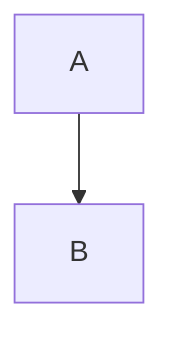

# Encabezado con *énfasis* y `código`

## Encabezado con atributos {#mi-id .clase}

Párrafo con "comillas rectas", 'simples', guion -- largo --- y puntos suspensivos...

**Negrita**, *cursiva*, ~~tachado~~, H~2~O, x^2^, ==resaltado==.

Enlace [con título](https://example.com "Título") y autoenlace <https://example.com> y suelto https://example.com.

Nota al pie[^1] y nota en línea^[Esta nota va en línea.].

[^1]: Texto de la nota al pie.


Imagen en línea  dentro de un párrafo.

Fórmula en línea $E = mc^2$ y en bloque:

$$
\int_0^\infty e^{-x^2}\,dx = \frac{\sqrt{\pi}}{2}
$$

- [ ] Tarea pendiente
- [x] Tarea hecha

1. Uno
2. Dos

a. Lista con letras
b. Segunda

i. Romanos
ii. Segundo

(@) Ejemplo numerado.
(@) Otro ejemplo.

Término
:   Definición del término.

> Cita en bloque
> con dos líneas.

> [!NOTE]
> Alerta al estilo de GitHub.

| Columna A | Columna B |
|:----------|----------:|
| izquierda | derecha   |

+-------+-------+
| Grid  | Tabla |
+=======+=======+
| a     | b     |
+-------+-------+

  Simple  Tabla
  ------- -------
  a       b

```rust
fn main() {
    println!("hola");
}
```



::: aviso
Div con clase (fenced div).
:::

[texto con clase]{.marcado}

| Línea de verso
|     con sangría

<div class="crudo">HTML <em>crudo</em></div>

Salto de línea con barra\
invertida.

Texto con \LaTeX\ crudo y \textbf{negrita LaTeX}.

[@cita2020] cita bibliográfica.

* * *

Fin.
