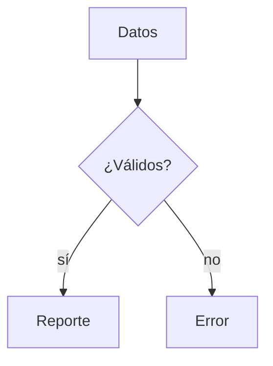

**Tercera beta** de la 0.5.0, con tres funciones nuevas para documentos largos y técnicos.
Puede tener errores: si encuentras alguno, abre un issue.

## Esquema de títulos

Un panel a la izquierda del editor lista los títulos del documento. Se abre con el botón
nuevo de la barra de título (a la izquierda de los botones de vista) o con
**`Ctrl+Shift+O`**.

- Un clic en un título lleva a esa sección.
- La sección donde está el cursor queda resaltada.
- Se recuerda abierto o cerrado, y se oculta en el modo enfoque.

## Scroll sincronizado

En la vista dividida, la vista previa acompaña al editor mientras te desplazas, sección por
sección. Ya no salta al principio cada vez que escribes. Con la vista previa sola, conserva
la posición a la que la llevaste.

## Diagramas Mermaid

Un bloque de código `mermaid` se dibuja como diagrama en la vista previa:

````markdown

````

Funciona sin conexión a internet y sigue al tema oscuro. Si el diagrama tiene un error, se
muestra el código con el motivo debajo para que puedas corregirlo. Por ahora, al exportar a
HTML o PDF los diagramas salen como código.

## Lo que ya traían las betas anteriores

Logo nuevo, pegar y arrastrar imágenes, diccionario personal, zoom del texto (también sobre
la vista previa), imágenes ampliables con doble clic, código legible en el tema oscuro,
vista previa flotante y `elision view`. El detalle está en las notas de la
[beta.1](https://github.com/GerardoFC8/apostrophe-for-windows/releases/tag/v0.5.0-beta.1) y
la [beta.2](https://github.com/GerardoFC8/apostrophe-for-windows/releases/tag/v0.5.0-beta.2).

## Instalación

Descarga **`Elision_0.5.0-beta.3_x64-setup.exe`** y ejecútalo: se instala encima de la
beta anterior o de la 0.4.x y conserva tus preferencias. Como toda beta, trae solo el
instalador NSIS y no se publica en winget.

> El instalador **no está firmado**. Windows SmartScreen mostrará "Editor desconocido":
> **Más información** → **Ejecutar de todas formas**.

## Licencia

GPL-3.0-or-later. Este proyecto deriva del código de Apostrophe (GNOME), licenciado bajo
los mismos términos.
