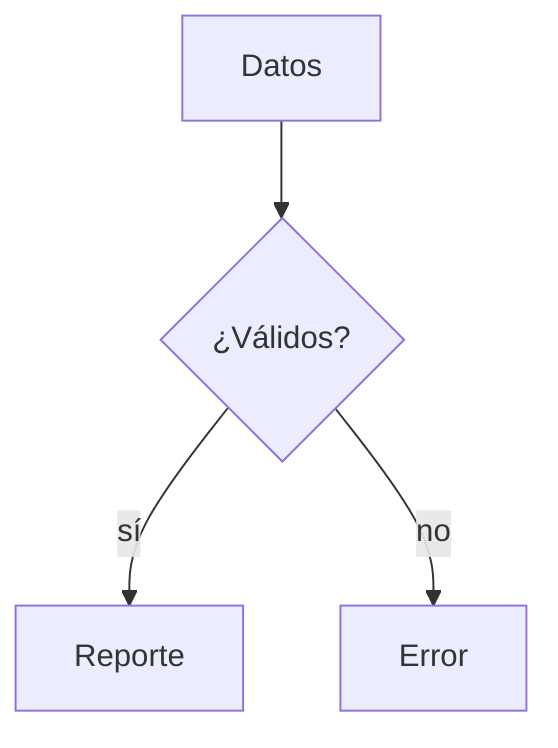

**Versión beta** de la 0.5.0: reúne todas sus novedades para probarlas antes de la versión
final. Puede tener errores: si encuentras alguno, abre un issue.

## Logo nuevo

Elision estrena ícono propio: una "e" con su apóstrofo, que es justamente una elisión.
Aparece en el acceso directo, la barra de tareas, el instalador y "Aplicaciones instaladas".

> Si el acceso directo sigue mostrando el ícono anterior, es la caché de íconos de Windows:
> se actualiza sola al rato o al reiniciar la sesión.

## Esquema de títulos

Un panel a la izquierda del editor lista los títulos del documento. Se abre con el botón de
la barra de título (a la izquierda de los botones de vista) o con **`Ctrl+Shift+O`**. Un clic
lleva a la sección y la sección del cursor queda resaltada.

## Scroll sincronizado

En la vista dividida, la vista previa acompaña al editor mientras te desplazas, sección por
sección, y ya no salta al principio cada vez que escribes.

## Diagramas Mermaid

Un bloque de código `mermaid` se dibuja como diagrama en la vista previa:

````markdown

````

Funciona sin internet y sigue al tema oscuro. Si el diagrama tiene un error, se muestra el
código con el motivo debajo. Por ahora, al exportar a HTML o PDF salen como código.

## Imágenes

- **Ctrl+V** con una imagen en el portapapeles (por ejemplo, una captura de
  `Win+Shift+S`) la guarda en una carpeta `assets` junto al documento e inserta
  ``. El documento tiene que estar guardado.
- **Arrastra** imágenes a la ventana para insertarlas donde las sueltes, o un `.md` para
  abrirlo en una pestaña.
- **Doble clic** sobre una imagen de la vista previa la amplía; clic o `Esc` la cierra.

## Diccionario personal

Clic derecho sobre una palabra subrayada → **Agregar al diccionario**. El corrector deja de
marcarla en todos tus documentos, sin distinguir mayúsculas. La lista es un archivo de texto
(`personal-dictionary.txt`, en la carpeta de datos de la aplicación) editable a mano.

## Zoom del texto

`Ctrl +`, `Ctrl -` y `Ctrl 0`, o `Ctrl` + rueda del mouse, sobre el editor o sobre la vista
previa. Cambia la letra del editor y de la vista previa, no la interfaz ni lo que exportas,
y se recuerda.

## Vista previa flotante

En la vista previa en ventana aparte, al pasar el mouse aparecen una **chincheta** para
dejarla siempre visible y un control de **opacidad del fondo**: sirve para leerla encima de
otra aplicación mientras escribes.

## Código legible en el tema oscuro

El resaltado de los bloques de código tiene su propia paleta en el tema oscuro; antes
algunos colores casi no se veían. El claro, el sepia y lo que exportas no cambian.

## `elision view`

Muestra un documento con formato en la terminal, ajustado a su ancho:

```powershell
elision view notas.md
```

## Instalación

Descarga **`Elision_0.5.0-beta.3_x64-setup.exe`** y ejecútalo: se instala encima de la
0.4.x o de una beta anterior y conserva tus preferencias. Como toda beta, trae solo el
instalador NSIS y no se publica en winget.

> El instalador **no está firmado**. Windows SmartScreen mostrará "Editor desconocido":
> **Más información** → **Ejecutar de todas formas**.

## Licencia

GPL-3.0-or-later. Este proyecto deriva del código de Apostrophe (GNOME), licenciado bajo
los mismos términos.
